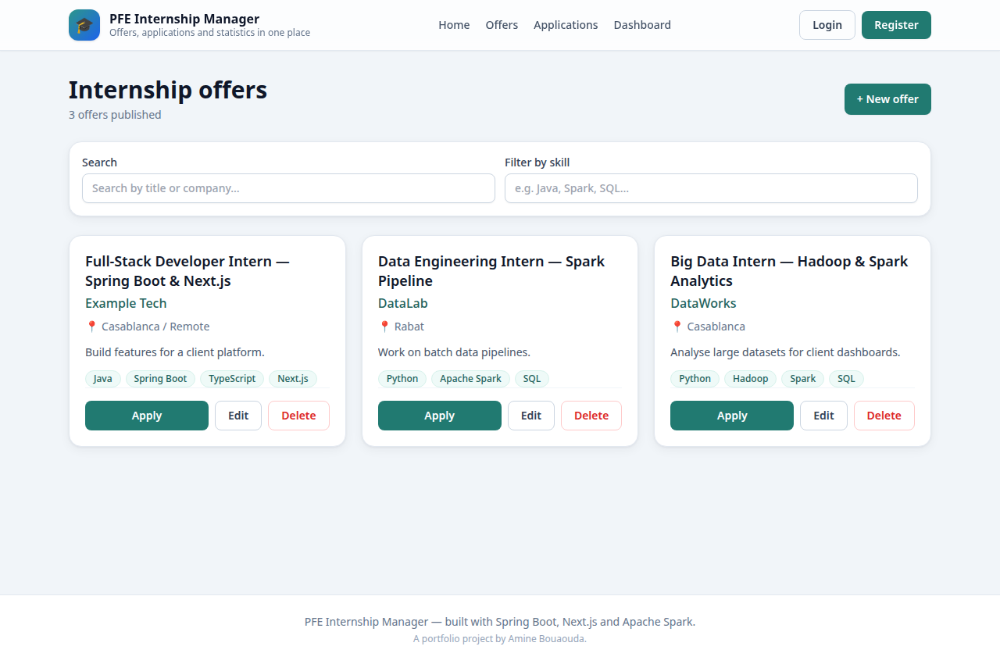
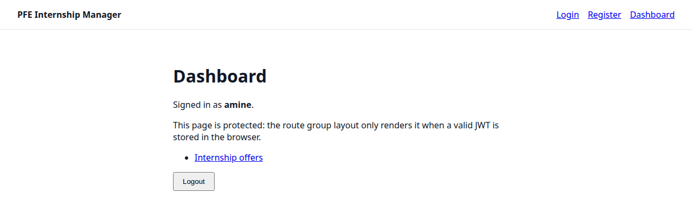

# PFE Internship Manager

A platform to manage PFE (Projet de Fin d'Études) internship offers, student applications, and supervisor assignments — with statistics computed via Apache Spark.

Students can browse offers, companies/supervisors can publish and track offers, and admins get simple stats (e.g. most requested skills, applications per offer) generated from application data.

## Screenshots

The app running locally, with sample data:

**Internship offers** (`/offers`, login required)



**Dashboard** (`/dashboard`, login required)



## Tech Stack

- **Backend:** Spring Boot 3 (Java 17), Spring Data JPA, Spring Security, PostgreSQL
- **Frontend:** Next.js 14 (TypeScript, App Router), Tailwind CSS
- **Big Data:** Apache Spark (PySpark) — batch stats on applications
- **Infrastructure:** Docker Compose (PostgreSQL for local dev)

## Architecture Overview

```
pfe-internship-manager/
├── backend/     # Spring Boot REST API
│   └── src/main/java/com/amine/pfemanager/
│       ├── model/       # JPA entities: InternshipOffer, Application
│       ├── repository/  # Spring Data repositories
│       ├── controller/  # REST controllers (HealthController for Day 1)
│       └── config/      # Security configuration
├── frontend/    # Next.js 14 app (App Router)
│   ├── app/     # layout.tsx, page.tsx
│   └── lib/     # api.ts fetch helper
└── big-data/    # Spark jobs
    ├── spark/   # skills_stats.py — applications per skill
    └── data/    # sample CSV data
```

Data flow:
1. Frontend (Next.js) calls Backend REST API (`/api/...`)
2. Backend reads/writes PostgreSQL
3. Exported application data (CSV) is processed by the Spark job in `big-data/` to produce stats

## How to Run (Docker Compose)

Start PostgreSQL:

```bash
docker compose up -d
```

Run the backend:

```bash
cd backend
./mvnw spring-boot:run
# or: mvn spring-boot:run
# Health check: http://localhost:8080/api/health
```

Run the frontend:

```bash
cd frontend
npm install
npm run dev
# http://localhost:3000
```

Run the Spark stats job (requires Spark installed locally):

```bash
cd big-data
spark-submit spark/skills_stats.py data/sample_applications.csv
```

## Roadmap

- [x] **Day 1** — Project scaffold: repo structure, Docker Compose with PostgreSQL, Spring Boot app with Health endpoint, JPA entities (`InternshipOffer`, `Application`), Next.js home page, Spark job skeleton
- [x] InternshipOffer CRUD API (`/api/offers`)
  - [x] `InternshipOfferController`: full CRUD, `InternshipOfferRequest` DTO with `@Valid`
- [x] Application submission API (`/api/applications`)
  - [x] `ApplicationController`: create (linked to an offer, starts PENDING), list/detail/status-update/delete; `ApplicationRequest` DTO with `@Valid`
- [x] JWT authentication (students / supervisors / admin roles)
  - [x] `User` entity with `ROLE_STUDENT` / `ROLE_SUPERVISOR` / `ROLE_ADMIN`, `AuthController` (`/api/auth/register`, `/api/auth/login`), JWT filter, BCrypt password hashing
  - [x] `/login` and `/register` pages, token stored in the browser, protected route group with `/dashboard`
- [x] Frontend: offers list page connected to API
  - [x] `/offers` page under the protected route group, linked from `/dashboard`
- [ ] Frontend: application form
- [ ] Supervisor assignment workflow
- [ ] Spark stats: run on real exported data and expose results via API
- [ ] Dashboard page with charts
- [ ] Tests (backend unit tests, frontend lint/build in CI)
- [ ] Deployment guide

## Author

Amine Bouaouda — PFE internship project
GitHub: [@aminebouaouda02](https://github.com/aminebouaouda02)

## License

MIT — for learning and portfolio purposes.
