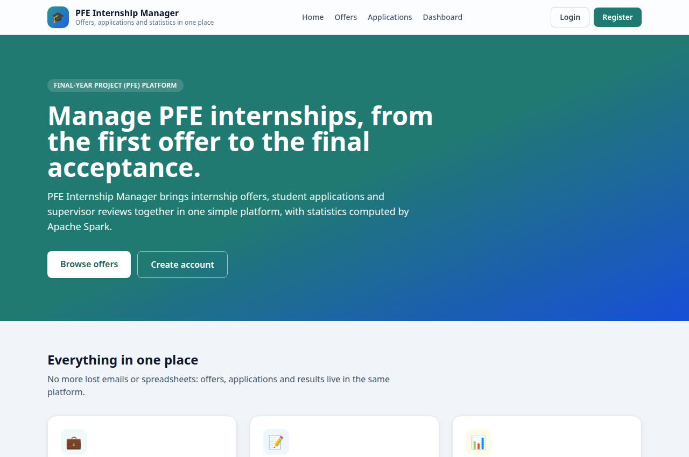
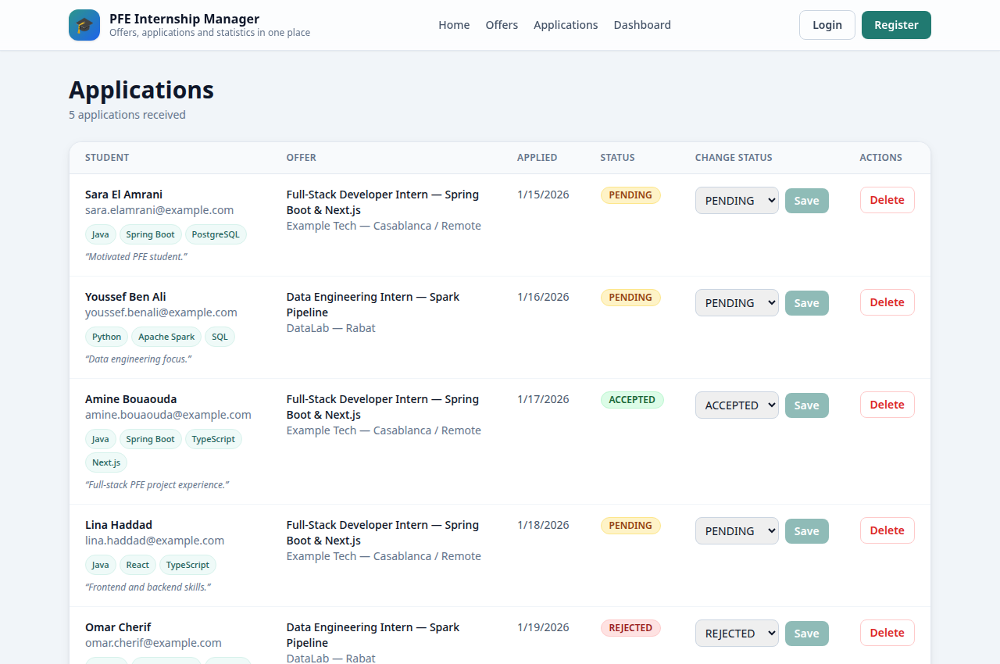

# PFE Internship Manager

A platform to manage PFE (Projet de Fin d'Études) internship offers, student applications, and supervisor assignments — with statistics computed via Apache Spark.

Students can browse offers, companies/supervisors can publish and track offers, and admins get simple stats (e.g. most requested skills, applications per offer) generated from application data.

## Screenshots

The app running locally, with sample data:

**Home page** (`/`)



**Internship offers** (`/offers`, login required)


**Applications** (`/applications`, login required)



**Dashboard** (`/dashboard`, login required)


## Tech Stack

- **Backend:** Spring Boot 3 (Java 17), Spring Data JPA, Spring Security, PostgreSQL
- **Frontend:** Next.js 14 (TypeScript, App Router), Tailwind CSS
- **Big Data:** Apache Spark (PySpark) — batch stats on applications
- **Infrastructure:** Docker Compose (PostgreSQL by default; Hadoop HDFS + Spark under the `bigdata` profile)

## Architecture Overview

```
pfe-internship-manager/
├── backend/     # Spring Boot REST API
│   └── src/main/java/com/amine/pfemanager/
│       ├── model/       # JPA entities: InternshipOffer, Application
│       ├── repository/  # Spring Data repositories
│       ├── controller/  # REST controllers (offers, applications, auth, analytics)
│       └── config/      # Security configuration
├── frontend/    # Next.js 14 app (App Router)
│   ├── app/     # layout.tsx, page.tsx
│   └── lib/     # api.ts fetch helper
└── big-data/    # Spark jobs
    ├── spark/   # skills_stats.py — applications per skill
    └── data/    # sample CSV data
```

Data flow:
1. Frontend (Next.js) calls Backend REST API (`/api/...`)
2. Backend reads/writes PostgreSQL
3. Exported application data (CSV) is processed by the Spark job in `big-data/` to produce stats

## How to Run (Docker Compose)

From a clean checkout, starting the database, backend and frontend takes
under 10 minutes (plus `npm install` the first time).

### Demo data and demo flow

To try the app without creating anything by hand, start the backend with
seeding switched on:

```bash
cd backend
SEED_ENABLED=true mvn spring-boot:run
```

On startup, `DataSeeder` fills only tables that are still empty (so a
restart never duplicates rows) with:

- demo accounts: student `demo` and supervisor `supervisor`, both with
  password `demo12345` (local demo only — override it with the
  `DEMO_PASSWORD` environment variable, and never enable seeding against a
  shared or production database)
- 6 internship offers across Casablanca, Rabat and Marrakech
- 5 applications in PENDING, ACCEPTED and REJECTED states

Then open http://localhost:3000, log in as `demo` / `demo12345`, and the
offers pages, applications pages and dashboard are already populated.
Seeding is off by default: without `SEED_ENABLED=true`, register an
account, then create offers and applications through the UI or the API
below.

Start PostgreSQL:

```bash
docker compose up -d
```

Start the Big Data profile (optional — Hadoop HDFS + Spark):

```bash
docker compose --profile bigdata up -d
```

This starts PostgreSQL plus the Hadoop NameNode and DataNode. The
`bigdata` profile is optional on purpose: the default `docker compose up`
stays light. NameNode web UI: http://localhost:9870 — HDFS address:
`hdfs://localhost:9000`.

```bash
# Check HDFS is up
docker compose --profile bigdata exec namenode hdfs dfs -ls /

# Run the Spark job inside a container (one-shot, not a daemon)
docker compose --profile bigdata run --rm spark \
  spark-submit spark/skills_stats.py data/sample_applications.csv

# Stop everything
docker compose down
```

The Spark job still reads local CSV files by default; reading its input
from HDFS is the next step (see `big-data/README.md`).

Run the backend:

```bash
cd backend
mvn spring-boot:run
# Health check: http://localhost:8080/api/health
```

Run the frontend:

```bash
cd frontend
npm install
npm run dev
# http://localhost:3000
```

Run the Spark stats job (requires Spark installed locally):

```bash
cd big-data
spark-submit spark/skills_stats.py data/sample_applications.csv
```

## API Reference

Base URL when the backend runs locally: `http://localhost:8080`.
Interactive docs (Swagger UI): `http://localhost:8080/swagger-ui.html`,
raw OpenAPI JSON: `http://localhost:8080/v3/api-docs`.
All endpoints except health, auth and the docs themselves require an
`Authorization: Bearer <token>` header, using the token from login.

| Method | Endpoint | Auth | What it does |
|--------|----------|------|--------------|
| GET | `/api/health` | No | Backend health check |
| POST | `/api/auth/register` | No | Create an account, returns a JWT |
| POST | `/api/auth/login` | No | Log in, returns a JWT |
| GET | `/api/offers` | Yes | List offers, optional `?location=` filter |
| GET | `/api/offers/{id}` | Yes | One offer |
| POST | `/api/offers` | Yes | Create an offer |
| PUT | `/api/offers/{id}` | Yes | Update an offer |
| DELETE | `/api/offers/{id}` | Yes | Delete an offer |
| GET | `/api/applications` | Yes | List applications, optional `?offerId=` filter |
| GET | `/api/applications/{id}` | Yes | One application |
| POST | `/api/applications` | Yes | Apply to an offer (starts as PENDING) |
| PUT | `/api/applications/{id}/status?status=` | Yes | Change an application's status |
| DELETE | `/api/applications/{id}` | Yes | Delete an application |
| GET | `/api/analytics/skills` | Yes | Latest Spark result: applications per skill |

Example calls (copy-paste ready, same style as a Postman collection):

```bash
# 1. Register, then log in and save the token
curl -X POST http://localhost:8080/api/auth/register \
  -H "Content-Type: application/json" \
  -d '{"username":"demo","email":"demo@example.com","password":"demo12345"}'

TOKEN=$(curl -s -X POST http://localhost:8080/api/auth/login \
  -H "Content-Type: application/json" \
  -d '{"username":"demo","password":"demo12345"}' \
  | node -e "let d='';process.stdin.on('data',c=>d+=c).on('end',()=>console.log(JSON.parse(d).token))")

# 2. Create an offer
curl -X POST http://localhost:8080/api/offers \
  -H "Authorization: Bearer $TOKEN" -H "Content-Type: application/json" \
  -d '{"title":"PFE Data Engineering Intern","description":"Build Spark pipelines","company":"Example Corp","supervisorName":"Sara El Amrani","requiredSkills":"Spark, SQL, Python","location":"Casablanca"}'

# 3. List offers and read the analytics result
curl http://localhost:8080/api/offers -H "Authorization: Bearer $TOKEN"
curl http://localhost:8080/api/analytics/skills -H "Authorization: Bearer $TOKEN"
```

Error codes: `400` for invalid input, `401` for a missing or bad token,
`404` for an unknown id, `409` when registering an existing username.

## Roadmap

- [x] **Day 1** — Project scaffold: repo structure, Docker Compose with PostgreSQL, Spring Boot app with Health endpoint, JPA entities (`InternshipOffer`, `Application`), Next.js home page, Spark job skeleton
- [x] InternshipOffer CRUD API (`/api/offers`)
  - [x] `InternshipOfferController`: full CRUD, `InternshipOfferRequest` DTO with `@Valid`
- [x] Application submission API (`/api/applications`)
  - [x] `ApplicationController`: create (linked to an offer, starts PENDING), list/detail/status-update/delete; `ApplicationRequest` DTO with `@Valid`
- [x] JWT authentication (students / supervisors / admin roles)
  - [x] `User` entity with `ROLE_STUDENT` / `ROLE_SUPERVISOR` / `ROLE_ADMIN`, `AuthController` (`/api/auth/register`, `/api/auth/login`), JWT filter, BCrypt password hashing
  - [x] `/login` and `/register` pages, token stored in the browser, protected route group with `/dashboard`
- [x] Frontend: offers list page connected to API
  - [x] `/offers` page under the protected route group, linked from `/dashboard`
- [x] Frontend detail pages — offer detail view with edit form and its applications, application detail view with status change; both show loading and error states, and list pages link to the detail pages
- [ ] Frontend: application form
- [ ] Supervisor assignment workflow
- [x] Spark stats: applications per skill on a generated 600-row sample, result JSON served by `GET /api/analytics/skills`
- [x] Dashboard page with charts
  - [x] `/dashboard` shows an applications-per-skill bar chart from `GET /api/analytics/skills`, with a clear note instead of a chart if the Spark result has not been generated yet
- [x] Hadoop integration — HDFS in Docker Compose under the `bigdata` profile (NameNode + DataNode) and a Spark job-runner service; Spark jobs still read local CSV by default, reading from HDFS is the next step
- [x] Backend tests (13 JUnit/Mockito tests: `InternshipOfferControllerTest`, `ApplicationControllerTest`, `AuthControllerTest` — create/list/filter, 404/400/409/401 cases, applications starting as PENDING)
- [ ] Frontend component test setup (deferred: adding Jest + Testing Library needs new dev dependencies and a verified install, so it will be set up with the CI work rather than added unverified)
- [x] Polish & documentation — README rewritten for the finished features, API reference table with copy-paste examples, OpenAPI/Swagger UI enabled, setup under 10 minutes
- [x] CI — GitHub Actions runs the backend tests and the frontend build on every push to main and every pull request (`.github/workflows/ci.yml`)
- [x] Seed data and demo flow — `DataSeeder` (off by default, `SEED_ENABLED=true`) seeds demo student/supervisor accounts, 6 offers and 5 applications into empty tables only; the demo login is documented above
- [ ] Deployment guide

## Continuous integration

`.github/workflows/ci.yml` runs on every push to `main` and on every pull
request, in two jobs: the backend job sets up Java 17 and runs `mvn -B test`
in `backend/`; the frontend job sets up Node.js 20, runs `npm ci` and
`npm run build` in `frontend/`. The backend tests are unit tests with mocked
repositories, so CI needs no database. A green check on a pull request means
the code builds and the tests pass; see the Actions tab on GitHub for the run
history.

## Tests

Backend unit tests live in `backend/src/test/java/...` and use JUnit 5
with Mockito (repositories mocked, no database needed). Run them with:

```bash
cd backend
mvn test
```

Note: Java/Maven are not installed in the workspace where this work was
prepared, so the tests were checked for consistency with the controllers
(signatures, status codes, DTO fields) but not executed there — run
`mvn test` locally or in CI to see them pass.

## Author

Amine Bouaouda — PFE internship project
GitHub: [@aminebouaouda02](https://github.com/aminebouaouda02)

## License

MIT — for learning and portfolio purposes.
